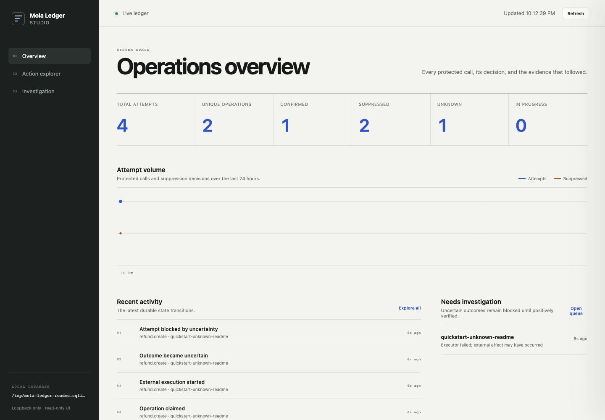

# Mola Ledger

**Know what your AI agents did. Prevent what they shouldn't do twice.**

Monitor external actions, suppress duplicate executions, and investigate uncertain outcomes with a lightweight Node.js SDK and a built-in local dashboard. The SDK runs in your application, stores its ledger in embedded SQLite, and does not require an account, Docker, an API key, or a database server.



## Install

Node.js 22.16 or newer is required; Node.js 24 is recommended.

```bash
npm install mola-ledger
```

For source-based evaluation before an npm release, install `github:zaiderikat/Mola-Ledger` or the absolute path to a local checkout. The package import name is `mola-ledger`.

## Protect an action

```javascript
import { createLedger } from 'mola-ledger';

const ledger = createLedger(); // ./.mola-ledger/ledger.sqlite

try {
  const incident = await ledger.execute({
    id: 'incident-for-alert-1842-v1', // stable across retries and restarts
    namespace: 'support-agent',
    action: 'incident.create',
    input: { alertId: 1842, severity: 'high' },
    metadata: { agent: 'triage-agent' },
    providerReference: result => result.url,
    run: ({ idempotencyKey }) => provider.createIncident({
      alertId: 1842,
      severity: 'high',
      idempotencyKey,
    }),
  });
  console.log(incident);
} finally {
  await ledger.close();
}
```

The first call atomically claims the operation and runs the callback. A repeated call with the same identity and input returns the stored result without executing the provider again. A changed input for the same ID is rejected.

## Open Studio

From the same project directory:

```bash
npx mola-ledger studio
```

Open `http://127.0.0.1:4317`. Studio reads the same SQLite file and shows real attempt counts, current states, suppression decisions, recent activity, searchable operations, safe result summaries, timelines, and the `UNKNOWN` investigation queue. It refreshes while the application runs and is not part of the action execution path.

Use a custom path in both processes when needed:

```javascript
const ledger = createLedger({ storage: './data/agent-actions.sqlite' });
```

```bash
npx mola-ledger studio --storage ./data/agent-actions.sqlite
```

See [Studio usage](docs/STUDIO.md) for filters, security boundaries, and investigation workflow.

## Try the complete offline flow

In this repository:

```bash
npm install
npm run demo:quickstart
npm run studio
```

The credential-free demo creates one confirmed operation, calls it twice while executing its provider callback once, then records and blocks an ambiguous operation. Keep Studio open to inspect both histories. The deeper failure lab adds concurrent calls, a lost response, and a real child-process crash:

```bash
npm run demo:failures
```

Neither demo makes an external write. See [the failure lab guide](docs/FAILURE_DEMOS.md).

## Use it with a real AI agent

The repository includes a working [OpenAI Agents SDK + GitHub Issues example](docs/OPENAI_AGENTS.md). The agent selects a registered tool; the tool wraps the existing GitHub adapter with the embedded ledger. The stable request ID and approved issue payload come from trusted SDK local context, not from an identifier invented by the model.

Normal tests use controlled GitHub responses and never call OpenAI or create an issue. The live example is explicitly credential-gated.

## What it guarantees—and what it does not

| Behavior | Current behavior |
|---|---|
| Atomic claim for one `(namespace, operationId)` in one SQLite ledger | Yes |
| Concurrent duplicate callback suppression | Yes |
| Confirmed result cached across application restarts | Yes |
| Input/action identity remains immutable | Yes |
| Ambiguous failures and expired claims block blind replay | Yes—state becomes `UNKNOWN` |
| Positive provider evidence can reconcile success | Yes |
| Exactly-once external execution | **No** |
| Proof that a missing provider object means the action failed | **No** |
| Safe automatic retry from `UNKNOWN` | **No** |
| Protection for calls that bypass `ledger.execute()` | **No** |
| Shared coordination across independent hosts or Lambda filesystems | **No** |

If the callback throws, the provider may already have acted. The ledger records uncertainty when possible and throws `EffectUncertainError`; another `execute()` for that identity is blocked by `EffectUnknownError`. Reconcile only after affirmative evidence:

```javascript
await ledger.reconcile({
  id: 'incident-for-alert-1842-v1',
  namespace: 'support-agent',
  verify: async () => {
    const incident = await provider.findByBusinessOperation('incident-for-alert-1842-v1');
    if (!incident) return { status: 'unknown' };
    return {
      status: 'succeeded',
      result: incident,
      evidence: `Provider confirmed incident ${incident.id}`,
    };
  },
});
```

## Modes

- **Embedded mode (default):** `createLedger({ storage? })`; no server or ledger API key. Best for one trusted Node.js application or several local processes sharing the same local SQLite file.
- **Optional HTTP mode:** `new EffectLedger({ url, apiKey })`; retained for v0.2 compatibility and small single-host evaluation. It is not a new distributed or hosted product.

Read [operations](docs/OPERATIONS.md) and [security](SECURITY.md) before consequential use.

## When not to use it

Do not use Mola Ledger when provider-native idempotency and lookup already solve the problem completely; when you need multi-step workflow replay, timers, compensation, or durable orchestration; when you require multi-host coordination, managed availability, tenant isolation, or compliance controls; or when permanently uncertain operations are unacceptable and the provider offers no credible verification method.

See [the comparison guide](docs/COMPARISON.md) for provider-native keys, custom tables, Temporal, Restate, and DBOS.

## Documentation

- [SDK and reporting API](docs/API.md)
- [Studio dashboard](docs/STUDIO.md)
- [OpenAI Agents SDK integration](docs/OPENAI_AGENTS.md)
- [GitHub Issues adapter](docs/GITHUB_ISSUES.md)
- [Operations and optional HTTP backend](docs/OPERATIONS.md)
- [Security](SECURITY.md)
- [Alternatives and when not to use it](docs/COMPARISON.md)

## License

This repository is `UNLICENSED`. No permission to copy, modify, or redistribute the software is granted unless separately authorized by the owner.
